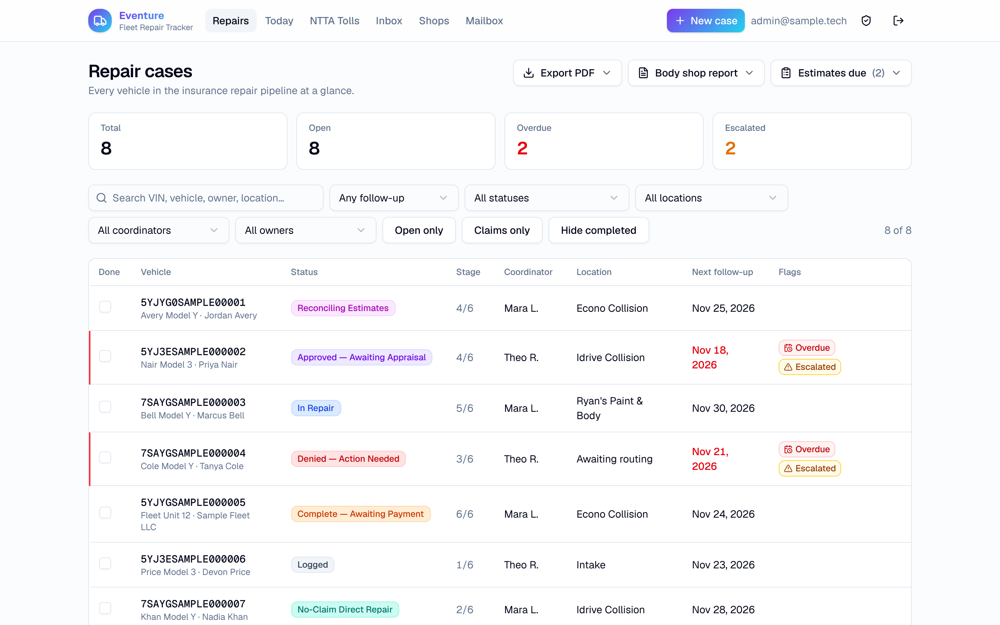

# Eventure Fleet Repair Tracker

The Eventure Fleet Repair Tracker is an internal operations app for running fleet vehicles through the auto-insurance collision-repair process end to end. When a fleet vehicle is damaged, a coordinator logs it, notifies the owner, decides whether the damage warrants an insurance claim (against a fixed deductible) or a direct repair, files and tracks the claim with the adjuster and appraiser, reconciles the body-shop and appraiser estimates (approving supplements when the shop's number exceeds the insurer's), moves the vehicle through repair, and closes it out once payment is made and the vehicle is returned, or settles it as a total loss. Around that pipeline the app adds a daily follow-up queue with auto-drafted emails, an inbound-email router that files Gmail correspondence and attachments to the right case automatically, a self-service body-shop portal, an NTTA toll-leakage tracking module, PDF/CSV reporting, and two-factor protection on destructive actions.

### 🔗 Live interactive prototype: **https://kadeemhaughton.github.io/Fleet-repair-tracker-/**

*A fully clickable, client-side walkthrough of the real app (dashboard, case pipeline, Today's queue, Inbox, body-shop portal, NTTA tolls, and reports), seeded with synthetic sample data. No backend, sign-in, or setup required.*

---

## Production

This application was **built, deployed, and used in production** as the internal fleet collision-repair operations system for **Eventure Consultants LLC**. It ran as a server-rendered Next.js app on **Netlify** backed by **Supabase** (Postgres, Auth with TOTP MFA, and Storage), with **Row Level Security enforced on every table** and a scheduled function driving automatic Gmail ingestion. The prototype linked above is a faithful, self-contained snapshot of that application running on synthetic data.

---

## What's in this repository

| Path | What it is |
|---|---|
| [`index.html`](index.html) | The live, self-contained interactive prototype that GitHub Pages serves. |
| [`docs/automation-and-ai-logic.md`](docs/automation-and-ai-logic.md) | A technical deep-dive on the automation: Gmail sync, the deterministic (keyless) inbound-email-to-case **routing engine**, attachment/document classification, and the follow-up **email drafter**, with the real weights, tiers, and guards. |
| [`docs/schema.sql`](docs/schema.sql) | The complete Postgres **schema**: 13 tables, enum types, 26 Row-Level-Security policies, the column-scoped `shop_cases` portal view, functions, and indexes, consolidated to current state. |

---

## Tech stack & deployment

- **Framework:** Next.js 16 (App Router, Server Components, Server Actions), `next@16.2.9`, built/dev with **Turbopack**.
- **UI:** **React 19** (`react@19.2.4`), **Tailwind CSS v4** (`@tailwindcss/postcss`), Radix UI primitives, `lucide-react` icons, `sonner` toasts, Geist / Geist Mono fonts.
- **Backend:** **Supabase** provides Postgres (typed via generated `lib/database.types.ts`), **Auth** (email/password + TOTP MFA), **Storage** (estimates / payments / documents buckets, served via signed URLs), and **Row Level Security** throughout. Access uses `@supabase/ssr`; privileged server writes (Gmail ingest, shop-user invites) use a service-role admin client.
- **Client-side libraries:** `jspdf` + `jspdf-autotable` (PDF reports), `pdf-lib` + `pdfjs-dist` (PDF compression/rasterize + text extraction), `browser-image-compression` + `heic2any` (image compression), `date-fns`.
- **Deployment:** **Netlify** via `@netlify/plugin-nextjs` (SSR, Server Actions, middleware/proxy, image optimization). Node 22. A Netlify **Scheduled Function** POSTs to the Gmail sync route with a shared `CRON_SECRET`. Public Supabase keys are inlined into the browser bundle (protected by RLS) and omitted from Netlify's secret scanner.
- **Config note:** `next.config.ts` tunes Router Cache `staleTimes` for instant Back/Forward navigation.

---

## The repair pipeline

Every case moves through **six stages** (`lib/status.ts` → `STAGES`), and each case carries exactly one **status** that maps to a stage (`STATUS_META`). The six stages:

1. **Log & Notify**
2. **Route**
3. **Claim Setup**
4. **Estimate & Reconcile**
5. **Repair**
6. **Close**

### Statuses (verbatim meanings from `lib/status.ts`)

| Status | Label | Stage | Meaning |
|---|---|---|---|
| `logged` | Logged | 1 | Vehicle logged at intake; owner not yet notified. |
| `owner_notified` | Owner Notified | 1 | Owner has been notified the vehicle is in repair. |
| `routing` | Routing | 2 | Deciding claim vs. no-claim based on the deductible. |
| `no_claim_direct_repair` | No-Claim Direct Repair | 2 | Under deductible, repairing directly without a claim. |
| `claim_filed_awaiting_adjuster` | Awaiting Adjuster | 3 | Claim filed; waiting on the insurance adjuster. |
| `claim_denied_action_needed` | Denied, Action Needed | 3 | Claim denied; decide between self-pay or appeal. |
| `claim_approved_awaiting_appraisal` | Approved, Awaiting Appraisal | 4 | Claim approved; waiting on the appraisal. |
| `reconciling_estimates` | Reconciling Estimates | 4 | Comparing appraiser and body-shop estimates. |
| `cleared_for_repair` | Cleared for Repair | 5 | Approved to begin repair work. |
| `in_repair` | In Repair | 5 | Vehicle is actively being repaired. |
| `complete_awaiting_payment` | Complete, Awaiting Payment | 6 | Repair complete; awaiting payment and return. |
| `closed` | Closed | 6 | Paid, returned, and closed. |
| `total_loss` | Total Loss | 6 | Vehicle declared a total loss; settling the claim. |

A case is **open** for all statuses except `closed` (`isOpen`). Each status also carries a consistent badge/dot color used across the dashboard, detail view, portal, and reports.

### How the pipeline enforces itself (`lib/state-machine.ts`)

Status changes run through a typed **transition table**, only valid "next steps" are offered, each with **required fields**, **presets**, **guards**, and **side effects**:

- `logged → owner_notified` requires owner contact + location; sets `owner_notified`.
- `routing → no_claim_direct_repair` / `claim_filed_awaiting_adjuster` requires a body shop + estimated damage; sets `claim_filed` accordingly.
- `claim_filed_awaiting_adjuster →` approved / denied / total-loss paths (gated on `claim_result`; total loss stamps `total_loss_date`).
- `claim_denied_action_needed →` self-pay (`in_repair`) or appeal (back to awaiting adjuster), both requiring a denial reason + next step.
- `reconciling_estimates → cleared_for_repair` is **blocked** unless any supplement is `approved` (see Estimates below).
- `complete_awaiting_payment → closed` requires payment marked made + vehicle returned; stamps `closed_date`.
- `total_loss → closed` requires settlement amount + next steps; stamps `closed_date`.
- A **manual override** mode lets staff set any status directly, skipping gates, still recorded in history.

---

## Capabilities by area

### Dashboard & filtering (`/` · `components/dashboard/dashboard-view.tsx`)

The home page is the operations board: every vehicle in the pipeline at a glance.

- **Summary stats:** Total, Open, Overdue, Escalated (counted across all cases, not just the filtered view).
- **Filters:** free-text **search** (VIN, vehicle, owner, location, coordinator); **follow-up/due** window (Any / Overdue / Due today / Due this week); **status**; **location**; **coordinator**; **owner**; plus three toggles, **Open only** (everything except Closed), **Claims only** (`claim_filed = true`), and **Hide completed** (hide cases whose follow-up is checked off). A "Clear" button appears when any filter is active, with an "X of Y" count.
- **Follow-up checkbox:** each open row has an optimistic "Done" checkbox that marks the case's follow-up task complete without opening it; completed rows dim and strike through their due date.
- **Row flags:** overdue (red left border + badge, only while open and not done) and escalation (amber) indicators; stage shown as `n/6`.
- **Responsive:** a desktop **table** (row click → case) and stacked **mobile cards** of the same data, with route prefetch on hover.
- **Exports** (three dropdown menus): **Management PDF** (all / open / by location / by owner), **Body-shop report** PDF (all / by shop / by location), and **Estimates due**, vehicles still missing a body-shop estimate, grouped per shop (with an "unassigned" bucket).

### Case management & the pipeline (`/cases/[id]` · `components/case/*`, `/cases/new`)

- **Intake** (`/cases/new`, `new-case-form.tsx`): quick form, VIN (required), vehicle name, owner name (required), owner contact, date in, location, coordinator, incident description.
- **Case header:** VIN, status badge, owner/vehicle, overdue/escalation badges, and inline-editable coordinator, location, date-in, and follow-up.
- **Pipeline progress bar** (`pipeline-progress.tsx`): the six stages with complete/current/upcoming state; the **no-claim branch** visibly **skips** Claim Setup (3) and Estimate & Reconcile (4); a **total loss** skips Repair (5).
- **Stage sections** (`lib/case-fields.ts`): every field grouped by stage (Log & Notify, Route, Claim Setup, Estimate & Reconcile, Repair, Close & Settlement), all inline-editable (text, phone, currency, date, boolean, claim result, supplement status). Includes **claim / adjuster / appraiser** fields (claim number, adjuster name & contact, claim result, denial reason/next step, appraiser name, contact & estimate).
- **Change status** dialog (`change-status-dialog.tsx`): offers only valid transitions, collects their required fields inline, shows the from→to badges, records who changed it and an optional audit note, or a manual override.
- **Needs-attention banner** lists active escalation reasons; **"Draft email"** and **Export** (management / body-shop) are one click from the header.
- **History timeline** at the bottom records every status change.

### Estimates & reconciliation (`components/case/estimates-panel.tsx`, `lib/business-rules.ts`)

- Two document columns, **Body shop** vs **Appraiser**, each supporting upload (PDF or photo) with an optional amount, plus view / download (signed URL) and delete (MFA-gated).
- The case tracks numeric `appraiser_estimate` and `body_shop_estimate` and their **gap**.
- **Supplemental rule (hard, `deriveSupplement`):** when the **body-shop estimate exceeds the appraiser estimate**, a supplement is **required**, `supplement_needed` is auto-set and `supplement_status` becomes `submitted` (kept if already submitted/approved). Otherwise it's `not_needed`. The case cannot clear `reconciling_estimates → cleared_for_repair` until the supplement is **`approved`** (state-machine guard), and the detail view shows a notice quantifying the overage until it is.

### Payments (`components/case/payments-panel.tsx`)

- Two logs: **Payments Made to Us** (inbound, logging one marks the case paid) and **Payments Made By Us** (outbound, e.g. paying the body shop).
- Each entry records amount, paid-on date, and method (Check, ACH, …) with a required proof document (PDF/JPEG/PNG), stored in the `payments` bucket and served via signed URL; view / download / delete (delete is MFA-gated).
- The dashboard and reports roll these up as paid-to-us / paid-by-us totals per case.

### Documents (`components/documents/*`, `lib/documents/*`)

- Reusable upload + list used for damage photos / image reports and NTTA receipts, keyed by `module` + `record_id` in the `documents` bucket.
- **Client-side compression before upload** (`compress.ts`): images (incl. HEIC via `heic2any`) → resized JPEG (~<300 KB); PDFs get a lossless cleanup, then page rasterization if still large, every path degrades gracefully to a still-valid file. Max 25 MB input.
- List supports view (signed URL), download, and MFA-gated delete.

### Notes & activity timeline (`components/case/notes-panel.tsx`, `updates-panel.tsx`, `history-timeline.tsx`)

- **Notes:** free-form internal notes; the two most recent feed the follow-up email drafter and action queue.
- **Contact log (updates):** structured record of who you heard from or reached out to, **party** (adjuster / appraiser / body shop / owner / other) × **direction** (inbound / outbound) × **channel** (call / email / voicemail / text / portal / in person / other), with a summary and occurred-on date. The panel highlights when you last heard back; "Log a reply" captures inbound updates quickly.
- **History timeline:** every status transition with timestamp, who, and note: the audit trail. The newest history row also tells the app when the case entered its current status (used for escalation timing).

### Business rules: overdue, escalation, stage, decoration (`lib/business-rules.ts`, `lib/config.ts`)

Server-computed flags attached to each case (`decorateCase`):

- **Deductible** is a fixed business constant: **$3,500** (`DEDUCTIBLE`). `deductibleRecommendation` is a *soft* recommendation (file a claim at/above it, direct repair below) the user can override.
- **Overdue** (`isOverdue`): an **open** case whose `next_follow_up` is before today. On every update to an open case `next_follow_up` is pushed to **+2 business days** (`FOLLOW_UP_BUSINESS_DAYS`), unless manually pinned.
- **Escalation** (`getEscalations`): a case stuck in an "awaiting" status (`claim_filed_awaiting_adjuster`, `claim_approved_awaiting_appraisal`) for more than **3 business days** (`ESCALATION_BUSINESS_DAYS`), and/or an **ETA that has passed** while the repair is not yet complete, each surfaced as a human-readable reason.
- **Stage** is derived from the status; **decoration** bundles overdue/escalation flags, stage, recent notes & inbound updates, and payment totals for the dashboard and detail views.

### Today: follow-ups due (`/today` · `components/today/action-queue-view.tsx`, `lib/followups.ts`)

The daily action queue: everything **overdue** or **due today**, each with a drafted email recommendation.

- Grouped Overdue / Due today with summary counts (+ Completed), ranked by a deterministic **priority score** (overdue age, ETA breach, time-in-status past per-stage SLA, dollar exposure, and note-signal boosts like "no reply", total loss, supplement pending, rental running).
- Each row shows the next action, the **recommended recipient**, when you last heard from them, status flags, an optimistic done checkbox, "Draft email", and "Log a reply". Print-friendly.
- **Auto-drafted follow-up emails (`lib/followups.ts`, keyless, no LLM/API):** expert, auto-claims-professional wording tailored to recipient and pipeline position, claim number in the subject, concrete "what we need to move forward" asks grounded in the state machine, note-aware tone (second-request phrasing when ignored, parts/supplement/total-loss/rental context), real-time deadlines computed from today, and owner cost-assistance messaging when a claim is denied or damage is below the deductible. Available from the case header and queue via the **Draft email** dialog: pick recipient, edit, then copy or open in the mail app.

### Inbox & automatic email routing (`/inbox` · `components/inbox/*`, `lib/email-routing.ts`)

A review queue for inbound email the router couldn't confidently place (staff-only; body-shop users are redirected).

- **Deterministic, rule-based routing: no LLM, no API key.** `lib/email-routing.ts` scores each email against an index of active cases using weighted signals: full **VIN** (100), VIN last-6, labeled/prefixed/digit **claim numbers**, **known sender** address/domain, and owner/vehicle/shop-name corroboration. Content outranks sender identity; near-ties, content-vs-sender conflicts, low confidence, and no-match go to the human queue rather than risk misfiling. Confidence is bucketed HIGH / MEDIUM / LOW / NONE.
- Automated mail (auto-replies, bounces, bulk/newsletters) is skipped. Security hardening throughout: input truncated to 64 KB, linear regexes, forward-header spoofing defenses, and sanitized summaries that carry no email-body text into staff-signed outbound drafts.
- **Review UI:** each queued email shows subject/sender, confidence tier + score, queue reason, snippet, matched signals, and candidate cases. One click to **assign** it to a case + party (optionally saving the sender to that contact), which logs a contact-log entry and files any attachments, or **ignore** it.

### Gmail mailbox sync (`/settings/mailbox` · `components/mailbox/*`, `lib/gmail/*`)

Link a shared Gmail inbox so incoming mail auto-files to the right case. **Read-only scope** (`gmail.readonly`): the app never sends, deletes, or modifies mail; only the **last 7 days** are ever read.

- **Connect** via Google OAuth; refresh tokens are **encrypted at rest** (AES-GCM). Clear, persistent error banners for common OAuth/origin misconfigurations. "Connect another", "Reconnect" on `needs_reauth`, and "Disconnect".
- **Sync now:** poll every message in the last 7 days. **Pull threads:** ingest the latest message of every thread. **Re-file docs:** re-classify already-ingested documents and move any mis-sorted ones (body-shop vs appraiser estimate, receipts → payments). Runs are idempotent (unique `gmail_message_id`, time-budgeted for Netlify's function limit, resumable).
- **Cadence:** per-mailbox auto-pull **Off / Daily / Weekly**, driven by a Netlify Scheduled Function that POSTs the sync route with `CRON_SECRET` (constant-time check; the route is the only path exempt from the auth gate and contacts only hard-coded Google hosts).
- **Attachment intelligence (`lib/gmail/attachments.ts`, keyless):** downloads PDFs/images, extracts PDF text so a bare "estimate attached" email can route on the VIN/claim *inside* the file, classifies each document (body-shop vs appraiser estimate / damage-image report / payment receipt), pulls estimate and paid amounts, and auto-files it to the matched case's estimates, documents, or payments, pinning a safe stored content-type.
- Gracefully degrades: if the Google credentials aren't configured, every other feature runs unchanged and the settings page explains what to set.

### Body-shop portal (`/portal` · `components/portal/*`, `lib/portal/*`)

A separate, scoped self-service area for body-shop logins: **a shop only ever sees its own vehicles**, through the RLS-scoped, column-limited `shop_cases` view.

- **Vehicle list** with status and a plain-language status hint; **vehicle detail** shows read-only vehicle + insurance info (claim #, adjuster, appraiser).
- Shops can **update repair progress** (repair-start and ETA dates), **upload their estimate** (body-shop or appraiser, with amount), **upload damage photos / image reports** (compressed, stored under the `damage_report` module), and **add notes** that staff can see.
- Its own header/layout; staff are redirected out of `/portal`, shop users are redirected into it, with a defense-in-depth role check in the portal layout.

### NTTA toll logs (`/ntta` · `components/ntta/*`, `lib/ntta/*`)

A standalone toll-leakage tracking module. "Leakage = money that left the company."

- **Log a toll** (`/ntta/new`): date + amount, and a **"Booking open?"** switch. **Off** = an **absorbed write-off**; **On** = a **chargeback** (bill the customer), which requires driver, license plate, VIN, toll-tag ID, and a charge amount, plus an "incidental completed" (recovered) flag and optional booking reference. An optional compressed receipt can be attached after saving.
- **Dashboard** (`/ntta`): metric cards (write-off, owed, recovered, total leakage), a month/year **leakage trend chart with spike markers**, and a filterable toll log (date range, category, incidental status). Total leakage = write-offs + owed; recovered money is *not* leakage.
- **Reports** (`/ntta/reports`): day/month/year management report with trends vs. the previous period, narrative insights, **spike detection** (statistical, elevated/severe), and **repeat-offender drivers** (≥3 tolls or ≥3 distinct days), sorted by amount owed, with recovery rates. **CSV export** and **Print/PDF**.

### Two-factor security (`/settings/security` · `components/security/*`, `lib/auth/mfa.ts`)

- **TOTP (Google Authenticator) MFA** via Supabase Auth: enroll by scanning a QR code (or entering the key) and confirming a 6-digit code; multiple authenticators and removal supported.
- A **step-up gate on destructive actions**: deleting a case or any uploaded document (estimates, payment proofs, NTTA receipts) requires a current code. If no factor is enrolled it's a no-op (never locks anyone out before they opt in); once enrolled, the action requires an `aal2` session with a TOTP verified in the last 5 minutes. A global `MfaProvider` prompts for the code inline right before the action runs.

### Exports & reports

- **Management PDF** (`lib/export-pdf.ts`): detailed per-vehicle report (status, pipeline fields, claim/estimate/payment data, recent notes) for any selection (all / open / by location / by owner, or a single case).
- **Body-shop handoff PDF** (`lib/body-shop-report.ts`): vehicle, claim, and damage with the adjuster/appraiser contacts front-and-center so a shop can pick up the insurance process.
- **Estimates-due PDF** (`lib/estimate-request-report.ts`): per-shop list of vehicles still awaiting a repair estimate, with business-days-waiting pressure numbers.
- **NTTA CSV + Print/PDF** report; Today's action queue is print-friendly.
- All document PDFs are generated client-side (`jspdf`/`jspdf-autotable`); case files are served via short-lived Supabase signed URLs.

### Roles & access control (RLS)

- **Authentication:** Supabase email/password; `lib/supabase/middleware.ts` refreshes the session on every request and redirects unauthenticated users to **`/login`** (and signed-in users away from it). The login page is the only unauthenticated route.
- **Role gate:** each profile has a role: **`staff`** or **`body_shop`**. The middleware routes **body-shop users to `/portal`** and keeps them out of the main app; staff use the main app and are kept out of `/portal`. Staff-only pages (Inbox, Shops) re-check the role server-side, and the portal layout re-checks as defense in depth.
- **Row Level Security** is enforced in Postgres: body shops read only their own vehicles (via the column-limited `shop_cases` view) and related estimates/notes/photos. Privileged operations that must bypass a user's RLS (Gmail ingestion and creating shop logins) run through a **service-role admin client** on the server only. Public (`NEXT_PUBLIC_*`) Supabase keys are safe in the browser precisely because RLS backs them.

---

## Roles

- **Staff** are Eventure coordinators. Full access to the repair pipeline, dashboard, case detail, intake, Today's action queue, Inbox review, Gmail mailbox settings, body-shop management (create shops, invite logins), NTTA tolls, exports, and security settings. Staff own the workflow and all status changes.
- **Body-shop portal users** are external shops, each invited with a login bound to one shop (temporary password shown once). They live entirely under `/portal` and see **only their own assigned vehicles**: read-only vehicle/insurance info plus the ability to update ETA/repair dates, upload their estimate and damage photos, and leave notes for staff. They cannot see other shops' vehicles, financials beyond their own estimate, or any staff-only tooling.

---

## Route map

| Route | Purpose |
|---|---|
| `/login` | Sign in (only unauthenticated route) |
| `/` | Dashboard: repair cases board |
| `/cases/new` | New case intake form |
| `/cases/[id]` | Case detail: pipeline, estimates, payments, notes, timeline |
| `/today` | Today's follow-up action queue |
| `/inbox` | Inbound-email review queue (staff) |
| `/ntta`, `/ntta/new`, `/ntta/logs/[id]`, `/ntta/reports` | NTTA toll-leakage module |
| `/settings/mailbox` | Gmail connect / sync / cadence (staff) |
| `/settings/shops` | Body-shop management & logins (staff) |
| `/settings/security` | Two-factor (TOTP) setup |
| `/portal`, `/portal/vehicles/[id]` | Body-shop portal (body-shop role only) |
| `/api/gmail/connect`, `/api/gmail/callback` | Gmail OAuth flow |
| `/api/gmail/sync` | Scheduler-triggered sync (CRON_SECRET; auth-gate exempt) |

---

> **About the prototype:** [`index.html`](index.html) is a static, client-side build of the application for demonstration. It is seeded with **synthetic sample data** (placeholder vehicles, owners, and `.example` email addresses) and makes **no network calls**: the Gmail, Supabase, and payment integrations described above are not live in the demo. It exists so the full interface and workflow can be explored directly in the browser.
